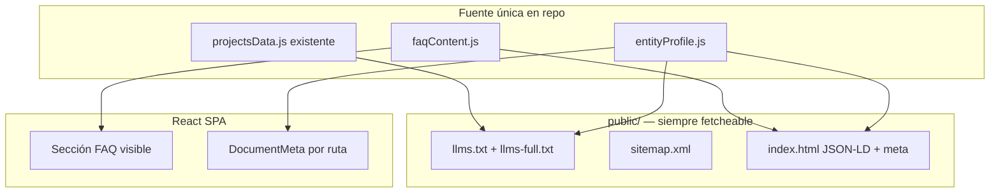

# Plan de implementación — GEO y AEO (SEO para IA)

**Objetivo:** que motores generativos (ChatGPT, Perplexity, Gemini, etc.) y answer engines puedan **descubrir, entender y citar** a Simón Ibalo y este portfolio como fuente primaria verificable.

**Seguimiento:** marcar `[x]` al cerrar cada ítem. Pedir implementación por fase (ej. *“implementá la Fase 1 del plan GEO/AEO”*).

**Estado global:** 🟡 En progreso (Fases 1–5 completadas; Fase 0 y 6 pendientes)

| Fase | Nombre | Estado |
|------|--------|--------|
| 0 | Baseline y queries objetivo | ⬜ |
| 1 | Capa de datos + contenido citables | ✅ |
| 2 | Descubrimiento para crawlers de IA | ✅ |
| 3 | Datos estructurados (JSON-LD) | ✅ |
| 4 | Indexación real (rutas + HTML estático) | ✅ |
| 5 | Prerender / fallback en build | ✅ |
| 6 | Medición e iteración | ⬜ |

---

## Relación con otros planes

- **`docs/seo-a11y-implementation-plan.md` (secciones 4–5):** title, description, OG en `index.html` / `404.html` y meta por ruta en la SPA son **prerrequisito compartido** con AEO. Ejecutar esa sección **antes o en paralelo con Fase 1–2** de este plan.
- **HashRouter:** migrado a **`BrowserRouter`** con `basename` de `PUBLIC_URL` (`/portfolio` en producción). Redirect legacy `#/…` en `LegacyHashRouteRedirect`. GitHub Pages: `404.html` + script en `index.html`.

---

## Arquitectura objetivo

---

## Fase 0 — Baseline y queries objetivo

**Por qué:** sin queries de referencia no se sabe si GEO/AEO mejoró.

- [ ] **0.1** Documentar 10–15 prompts de prueba (ES + EN), por ejemplo:
  - *¿Quién es Simón Ibalo / Simon Ibalo UX?*
  - *UX UI Engineer React Argentina portfolio*
  - *Simón Ibalo proyectos / track record*
- [ ] **0.2** Ejecutar esos prompts en Perplexity, ChatGPT (browse si hay), Gemini; anotar si aparece el sitio, GitHub, LinkedIn u otra fuente.
- [ ] **0.3** Guardar baseline en `docs/geo-aeo-baseline.md` (fecha + tabla prompt → fuentes citadas).

**Criterio de done:** archivo baseline con al menos 10 filas.

**Commit:** `docs: add GEO/AEO measurement baseline` (opcional, solo docs).

---

## Fase 1 — Capa de datos + contenido citables

**Por qué:** los LLM citan **hechos explícitos y consistentes**, no solo UI interactiva.

### 1.1 Perfil de entidad (fuente única)

- [x] Crear `src/data/entityProfile.js` con campos estables:
  - `fullName`, `alternateName` (Simon Ibalo), `jobTitle` (EN/ES)
  - `descriptionShort`, `descriptionLong` (EN/ES) — alineados con meta description
  - `yearsExperience`, `primarySkills[]`, `location` (ciudad/país si se publica)
  - `sameAs[]`: GitHub, LinkedIn, etc. (URLs absolutas)
  - `canonicalSite`: `https://simon8x.github.io/portfolio/`
- [x] Reutilizar datos existentes donde aplique (`homeContent`, `trackRecordData`, `projectsData`) sin duplicar narrativas largas; el perfil referencia o compone strings.

**Criterio de done:** un solo módulo importable desde schema, FAQ y `llms.txt` generator.

### 1.2 FAQ visible (AEO)

- [x] Crear `src/data/faqContent.js`: 8–12 pares pregunta/respuesta EN + ES (respuestas 2–4 oraciones, tono factual).
- [x] Ejemplos de temas: rol actual, años de experiencia, stack (React, UX/UI), tipo de proyectos, cómo contactar, idiomas, educación/formación si aplica.
- [x] Componente `src/components/faq-section/FaqSection.js` + estilos con tokens SCSS existentes.
- [x] Ubicación UI: pie de **Home** o sección colapsable antes del footer (decisión al implementar; preferir Home para una sola URL canónica `/`).

**Criterio de done:** FAQ en DOM como texto seleccionable (no solo imagen/modal).

**Commit sugerido:** `feat(geo): add entity profile and visible FAQ content`

---

## Fase 2 — Descubrimiento para crawlers de IA

**Por qué:** convenciones emergentes (`llms.txt`) y sitemap ayudan a bots a mapear el sitio sin ejecutar la SPA.

### 2.1 `llms.txt`

- [x] Agregar `public/llms.txt` (formato markdown breve):
  - Título, resumen profesional (EN primero o bilingüe)
  - Lista de URLs importantes con descripción de una línea
  - Enlace a `llms-full.txt` si existe
- [x] Agregar `public/llms-full.txt`: versión extendida (bio, lista de proyectos con 1 párrafo cada uno, FAQ en texto plano).

**Opción de mantenimiento:** script `scripts/generate-llms.js` (Node 8–compatible) que lea `entityProfile`, `faqContent`, `projectsData` y regenere ambos archivos en `prebuild` — evaluar en implementación para evitar drift manual.

### 2.2 Sitemap y robots

- [x] Crear `public/sitemap.xml` con URLs **reales publicables**:
  - Hoy con HashRouter: al menos `https://simon8x.github.io/portfolio/` y anclas documentadas; tras Fase 4: `/portfolio/projects`, `/track-record`, etc.
- [x] En `public/robots.txt`, agregar línea `Sitemap: https://simon8x.github.io/portfolio/sitemap.xml`
- [x] Mantener `User-agent: *` / `Allow` salvo política explícita contra bots (no bloquear GPTBot/PerplexityBot por defecto).

**Commit sugerido:** `feat(geo): add llms.txt, sitemap, and robots sitemap reference`

---

## Fase 3 — Datos estructurados (JSON-LD)

**Por qué:** schema.org da a las IA anclas tipadas (Person, CreativeWork, FAQPage).

- [x] **3.1** Bloque `<script type="application/ld+json">` en `public/index.html` (estático, visible sin JS):
  - `@graph`: `Person` + `ProfilePage` (o `WebSite` con `author`)
  - `sameAs`, `url`, `jobTitle`, `description`
- [x] **3.2** Componente o snippet en build: `FAQPage` con `mainEntity` desde `faqContent` (puede duplicarse en index estático o inyectarse vía script de build).
- [x] **3.3** (Opcional v1) `ItemList` de proyectos destacados con `name`, `description`, `url` a demo o ficha — datos desde `projectsData`.

**Validación:** Google Rich Results Test / Schema Markup Validator (manual, post-deploy).

**Commit sugerido:** `feat(aeo): add JSON-LD Person, ProfilePage, and FAQPage`

---

## Fase 4 — Indexación real (rutas sin hash)

**Por qué:** GEO/AEO escala mal si solo existe una URL indexable (`/` + hash ignorado).

**Decisión registrada:** migrar `HashRouter` → `BrowserRouter` en `src/App.js` con patrón gh-pages ya documentado en `public/404.html` (redirect a `index.html`).

- [x] **4.1** Cambiar router y actualizar tests que usan `HashRouter`.
- [x] **4.2** Verificar `homepage` en `package.json` y links internos (`Link`, redirects).
- [x] **4.3** Actualizar `sitemap.xml` con rutas limpias: `/`, `/projects`, `/track-record`, `/testimonial`.
- [x] **4.4** Alinear `og:url` y canonical por ruta cuando exista `DocumentMeta` (plan SEO sección 4).

**Riesgo:** enlaces externos antiguos con `#/` — mantener redirect en app de `#/projects` → `/projects` si es viable.

**Commit sugerido:** `fix(seo): replace HashRouter with BrowserRouter for crawlable routes`

---

## Fase 5 — Prerender / fallback en build

**Por qué:** CRA entrega un `
` vacío; muchos bots no renderizan JS.

### Decisión Fase 5

**Opción B ampliada (implementada):** `<noscript>` generado en **postbuild** desde `src/data/crawlerFallbackContent.js`. Se inyecta en `build/index.html` y en copias por ruta (`build/projects/index.html`, etc.) para que GitHub Pages sirva HTML con bio, FAQ o resumen de sección sin ejecutar React.

**Opción A (react-snap):** descartada en v1 para evitar dependencia pesada y fricción con React 18 en CRA.

- [x] **5.1** Elegir A o B y documentar en este archivo (subsección “Decisión Fase 5”).
- [x] **5.2** Implementar para al menos: `/`, `/projects`, `/track-record`, `/testimonial`.
- [x] **5.3** Confirmar que `view-source:` en producción muestra texto de bio + FAQ o listado de proyectos.

**Commit sugerido:** `feat(seo): prerender key routes for crawler-visible content`

---

## Fase 6 — Medición e iteración

- [ ] **6.1** Repetir los prompts de Fase 0 (mensual o post-deploy mayor).
- [ ] **6.2** Google Search Console: impresiones para nombre + “UX UI Engineer”.
- [ ] **6.3** Ajustar copy en `entityProfile`, FAQ y `llms-full.txt` donde las respuestas de IA sean incorrectas o omitan el portfolio.
- [ ] **6.4** Actualizar `docs/geo-aeo-baseline.md` con fila “post Fase X”.

**Criterio de éxito (realista para portfolio personal):**

- El sitio aparece citado o en fuentes en ≥ 3 prompts de marca/nombre.
- FAQ y bio son reproducibles por un LLM con datos que coinciden con el sitio.

---

## Orden de ejecución recomendado

1. **Fase 0** (rápida, desbloquea medición).
2. **SEO plan §4** (meta estáticos + 404) si aún no está hecho.
3. **Fases 1 → 2 → 3** (contenido + archivos estáticos + JSON-LD) — **mayor ROI sin tocar router**.
4. **Fase 4** (router) cuando se acepte el riesgo de URLs.
5. **Fase 5** si tras Fase 4 el HTML sigue vacío para bots.
6. **Fase 6** continua.

---

## Commits previstos (resumen)

| Orden | Mensaje |
|-------|---------|
| 1 | `docs: add GEO/AEO measurement baseline` |
| 2 | `feat(geo): add entity profile and visible FAQ content` |
| 3 | `feat(geo): add llms.txt, sitemap, and robots sitemap reference` |
| 4 | `feat(aeo): add JSON-LD Person, ProfilePage, and FAQPage` |
| 5 | `fix(seo): replace HashRouter with BrowserRouter for crawlable routes` |
| 6 | `feat(seo): prerender key routes for crawler-visible content` |

*(Los commits del plan SEO/a11y siguen siendo independientes y compatibles.)*

---

## Fuera de alcance (v1)

- Contenido oculto solo para bots o “LLM keyword stuffing”.
- Bloquear crawlers de IA sin política de privacidad clara.
- Migrar fuera de CRA/gh-pages (Next, Astro) — válido como v2 si Fase 5 no alcanza.
- Traducir todo el portfolio; basta entidad + FAQ + `llms` bilingües y meta alineados con `siteLang` donde ya exista.

---

## Notas para el agente implementador

- Respetar Node/React constraints del repo (sin `??` / `?.` en scripts si corren en entorno legacy; app ya es React 18).
- Colores/typography/spacing: variables en `_color-variables.scss`, `_typography-variables.scss`, `_spacing-variables.scss`, `_border-variables.scss`.
- Al cerrar cada fase: actualizar tabla **Estado global** y checkboxes en este archivo.
